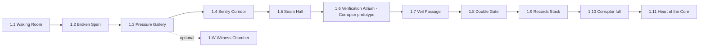
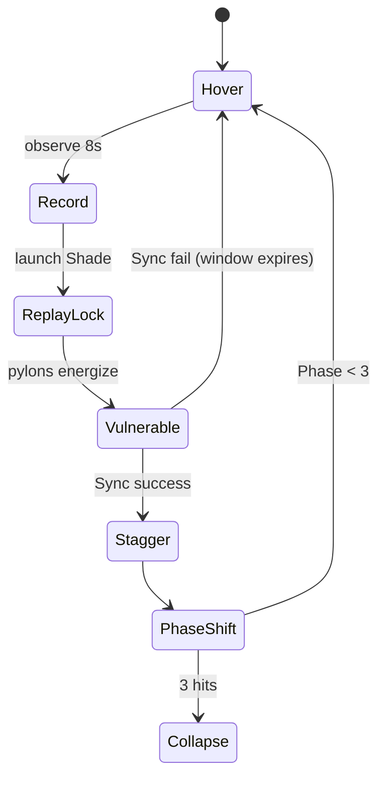

# 05 — Chapter 1: The Fragmented Core

**Theme:** Trust · **Spotlight:** Blitz · **Playable:** Blitz, Echo · **Boss:** Corruptor · **Shard:** I Verification
**Vertical slice = Rooms 1.1–1.6** (see §3).

## 1. Narrative purpose
Introduce the world, establish that the heroes are unverifiable to the Archive, introduce Echo Trace, and plant the first clue: security was left on deliberately. The player should leave unsettled, not informed.

## 2. Visual direction
Fractured circuit-board architecture, code-rain, dream fog, floating broken blocks. Palette: deep indigo base, cyan circuitry, violet fog, sparing pink for Beacons. Glitch only on Seams and Corruptor. Parallax: 4 layers (far fog, circuit towers, mid corridors, foreground debris). Reference `11`.

## 3. Level progression

| Room | Name | Purpose | Rules | Slice? |
|---|---|---|---|---|
| 1.1 | Waking Room | Movement/jump tutorial; opening text; heroes' voices | Move, jump, coyote | ✔ |
| 1.2 | Broken Span | Blitz dash across gaps; pulse trap | Dash | ✔ |
| 1.3 | Pressure Gallery | Introduce Trace via plate+door | Trace (hold) | ✔ |
| 1.4 | Sentry Corridor | Memory Sentry bait with Trace; Pulse + Release | Trace (bait), Pulse | ✔ |
| 1.5 | Seam Hall | Seams change layouts; traces dissolve | Seam | ✔ |
| 1.6 | Verification Atrium | Corruptor prototype (Phases 1–2) | Sync Window | ✔ |
| 1.7 | Veil Passage | Echo Veil Sight; hidden platforms | Veil | |
| 1.8 | Double Gate | Two plates, one trace + player | Weight 2 | |
| 1.9 | Records Stack | Corrupted Drone; replay movement | Drone | |
| 1.10 | Atrium (full) | Corruptor Phase 3 + Seams toggle | Seams + Sync | |
| 1.11 | Heart of the Core | Shard I; terminal reading "DERIVATIVE" | — | |
| 1.W | Witness Chamber | Optional; clause: **Identify the owner** | Trace + Seam | |

(Slice target length 10–15 min assumes 1.1–1.6 and ~2–3 min per room; `[VERIFY by playtest]`.)

## 4. Abilities introduced or tested
- Move/jump → 1.1; Dash → 1.2; Trace → 1.3; Pulse/Release → 1.4; Seam → 1.5; Veil → 1.7; Sync → 1.6/1.8; Hero swap (Blitz ↔ Echo) → 1.7.

## 5. Main puzzles (summary)
- **1.3 Pressure Gallery:** see `04` §2.3.
- **1.4 Sentry Corridor:** a sentry patrols a 10 BH corridor; the exit is behind it. **Solution:** record a short run across the sentry's visual cone, launch it; the sentry turns toward the "duplicate record"; player passes behind. **Failure:** trace too short; cue. **Alt:** Blitz dash through the gap timing.
- **1.5 Seam Hall:** three-state layout puzzle (see `04` §9).
- **1.8 Double Gate:** a plate needing weight 2. **Solution:** trace stands on plate for TR-03; player stands on second plate.
- **1.6/1.10 Corruptor:** see `03` C1; phase diagram below.

## 6. Optional: Witness Chamber 1.W
A short chamber where a "request" and a "record" disagree about who owns a memory. **Puzzle:** use a Trace across a Seam to match two records. **Yields:** Witness Clause 1 — *Identify the owner*. Testimony text is a single line (≤ 25 words).

## 7. Enemies and boss
Memory Sentry, Corrupted Drone, Seam Warden, Corruptor. Slice: Sentry + Corruptor prototype.

## 8. Environmental storytelling
- Release Seals appear as small door-shaped locks on corridor walls.
- A terminal in 1.11 shows "DERIVATIVE: PRIME ECHO (FINAL DRAFT)". The heroes cannot read the full entry yet (Ch4 updates it).
- Corridor outlines show prior layouts after Seam changes.

## 9. Checkpoints and difficulty curve
Beacons: before 1.2, 1.3, 1.5, 1.6 (before boss), between boss phases. Difficulty: 1.1 trivial → 1.3 easy → 1.4 moderate → 1.5 moderate → 1.6 hardest in slice.

## 10. Required assets and animations
See `11` §14 for the slice asset list. Chapter-specific: circuit tileset, code-rain VFX, Seam glyph, Sentry sprite, Drone sprite, Corruptor sprite sheet, Pylons, plates, doors, Beacon, terminal.

## 11. Player knowledge at entry / exit
- **Entry:** names, a vague goal. 
- **Exit:** the Archive sees them as "not recorded"; security was on purpose; Trace works; Shard I exists.

## 12. Mystery contribution
R1: security was deliberately left active; heroes are tagged DERIVATIVE.

## 13. Exit and completion criteria
- **Exit:** Shard I collected in 1.11; portal opens to Hub.
- **Complete:** boss resolved, Shard I held, autosave. Optional: 1.W clause, 8 fragments.
