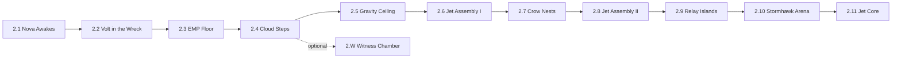
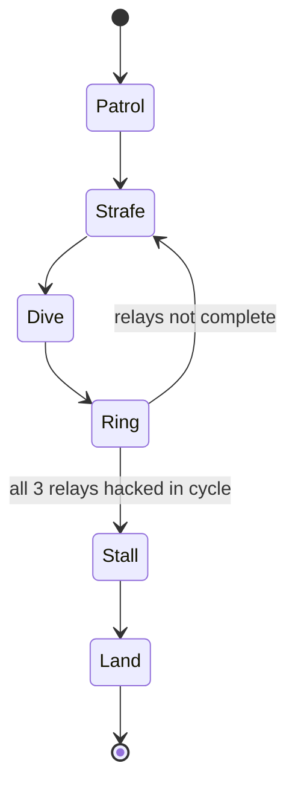

# 06 — Chapter 2: The Lost Sky

**Theme:** Possibility · **Spotlight:** Nova · **Playable:** Blitz, Echo, + Nova, Volt (unlocked in 2.1/2.2) · **Boss:** Stormhawk · **Shard:** II Retrieval

## 1. Narrative purpose
Show that memories can be abandoned by choice and that restoring one can hurt. Stormhawk is not a villain: it is a forced replay of a pilot's worst flight.

## 2. Visual direction
Dream sky; floating digital islands; shattered jet parts; transparent clouds that solidify under Veil Sight. Palette: pale violet sky, cyan islands, warm pink horizon, white engine glow. Parallax: 5 layers with strong vertical depth. Glitch used for gravity-zone edges only.

## 3. Level progression

| Room | Purpose | Rules | Notes |
|---|---|---|---|
| 2.1 | Unlock Nova; flight tutorial | Flight energy | Nova's Tether solidifies |
| 2.2 | Unlock Volt; hack tutorial | Hack | Volt finds a dead turret |
| 2.3 EMP Floor | Fly over EMP cell, pull lever | Flight vs EMP | |
| 2.4 Cloud Steps | Veil Sight solidifies clouds | Veil | Optional chamber branch |
| 2.5 Gravity Ceiling | Gravity zone flip | Gravity | |
| 2.6 Jet Assembly I | Place 2 parts; Volt powers | Hack + placement | Numbered lights |
| 2.7 Crow Nests | Crow carries part; bait it with Trace | Trace bait | |
| 2.8 Jet Assembly II | 3 parts, order by lights; trace holds relay | Trace + hack | |
| 2.9 Relay Islands | Three relays across islands | Nova + Volt | Pre-boss rehearsal |
| 2.10 Arena | Stormhawk | Pattern Cycle | |
| 2.11 Jet Core | Shard II; pilot's Release request | — | |
| 2.W | Witness Chamber: **Offer** | Trace + hack | |

## 4. Abilities introduced/tested
Nova flight (2.1), Volt hack (2.2), gravity zones (2.5), swap pairing (2.8), traces hold relays (2.8).

## 5. Puzzles
- **2.6 Jet Assembly I** (`04` §8): two parts, two relays, numbered power order. **Failure:** wrong order → parts reset, no damage.
- **2.8:** relay switch needs sustained hold. **Solution:** record Blitz holding relay (stand on plate), launch; swap to Nova to carry parts; swap to Volt to hack.
- **2.7:** crow steals a loose part; bait it with a trace carrying a marker object? Simplified: crow follows the nearest "moving object"; record a trace flying a loop; crow chases it; collect the part.
- **2.9 Relay Islands rehearsal:** same layout as the boss, no attacker.

## 6. Enemies and boss
Memory Crow, Fighter Drone, EMP Cell; Stormhawk (`03` C2).

## 7. Environmental storytelling
Floating Release Seals; a cockpit with a half-written release request; Stormhawk's loop repeating a single radio line (the same line, each time).

## 8. Checkpoints and difficulty
Beacons before 2.3, 2.6, 2.8, 2.9, and between Stormhawk phases. Difficulty: moderate, with the highest "swap management" load in 2.8.

## 9. Assets
Island tiles, cloud tiles (solid/ghost), jet part sprites (6), relay nodes, EMP floor VFX, crow, fighter drone, Stormhawk sprite sheet (loop poses), gravity-zone VFX, parallax set.

## 10. Entry/exit knowledge
- **Entry:** Shard I; heroes unverifiable.
- **Exit:** abandonment is a choice; restoring can hurt; Stormhawk's pilot asked to forget.

## 11. Mystery contribution
R2.

## 12. Exit and completion
Exit: Shard II collected at 2.11. Complete: Stormhawk landed; Beacon saved. Optional: 2.W clause 2 (*Offer*), fragments.
