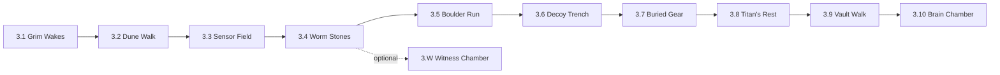
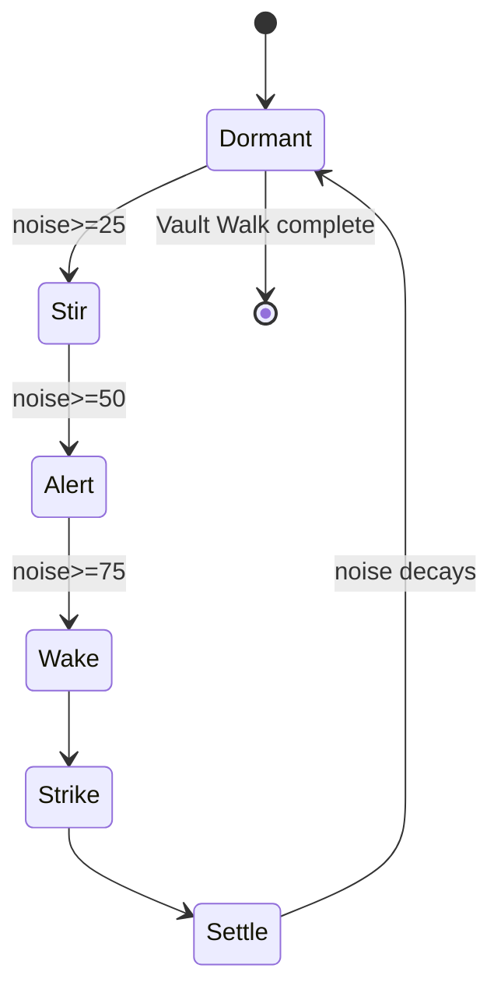

# 07 — Chapter 3: The Giant's Tomb

**Theme:** Fear · **Spotlight:** Grim · **Playable:** Blitz, Echo, Nova, Volt, + Grim (2.x end/3.1) · **Boss:** Titan Echo · **Shard:** III Sealing

## 1. Narrative purpose
Reveal that released memories are *stored and guarded*, and that fear can be protective. The Titan is a guardian, not a monster.

## 2. Visual direction
Dream-desert; dunes shifting with the Titan's breath; buried machinery; sandstorm particles; dream-haze shadows. Palette: dusty violet, deep teal, sand-pink, cold blue highlights. Parallax with heat shimmer. Noise feedback via ground ripples.

## 3. Level progression

| Room | Purpose | Rules |
|---|---|---|
| 3.1 | Grim; shield + muffle tutorial | Shield |
| 3.2 | Noise meter intro; walk vs run | Noise |
| 3.3 Sensor Field | Switch behind sensors; walk quietly | Noise |
| 3.4 Worm Stones | Worms sense ground steps; Nova/Shield/stone path | Perception |
| 3.5 Boulder Run | Noise triggers boulders; Shield-walk | Shield |
| 3.6 Decoy Trench | Trace emits noise elsewhere; lure scarabs | Trace as decoy |
| 3.7 Buried Gear | Machinery revealed by shifting sand | Timing |
| 3.8 Titan's Rest | Approach; first Stir | Meter |
| 3.9 Vault Walk | Quiet cross of the Vault; Veil + Shield | Combined |
| 3.10 Brain Chamber | Shard III | — |
| 3.W | **Confirm consent** | Trace + noise |

## 4. Abilities introduced/tested
Grim shield (3.1); noise (3.2); Trace as noise decoy (3.6); combined Veil + Shield (3.9).

## 5. Puzzles
- **3.3:** a lever across a sensor field; walking adds 1 NU/step with decay 4 NU/s; running accumulates. **Solution:** walk. **Failure:** Stir → scarabs investigate; reset.
- **3.6 Decoy Trench:** scarabs guard a path. **Solution:** record a run at the far side; launch; scarabs follow the noise; player walks the quiet route. **Fair:** trace emits visible noise rings.
- **3.9 Vault Walk (boss):** `03` C3. A route of quiet stone tiles between sleeping memory-capsules; the Titan is Dormant; any noise ≥ Stir causes a Slam with a 3 s telegraph. **Solution:** Veil reveals safe tiles, Shield muffles jumps.

## 6. Enemies and boss
Scarab Mech, Echo Worm, Rolling Boulder; Titan Echo.

## 7. Environmental storytelling
Vault capsules labeled with released memories; Release Seals on every capsule; a seal bearing five small sigils (hero marks) that Echo recognizes. The Titan pauses before striking if the noise source is a trace (it "listens").

## 8. Checkpoints and difficulty
Beacons before 3.3, 3.5, 3.6, 3.9, and mid-Vault-Walk. Difficulty: spike at 3.6; Vault Walk is a controlled test.

## 9. Assets
Dune tiles with shift animation, sand particles, sensor emitters, scarab, worm (tremor), boulder, Titan sprite (large, layered), Vault capsules, noise ripple VFX, Noise Meter UI.

## 10. Entry/exit knowledge
- **Entry:** abandonment can be chosen.
- **Exit:** abandoned memories are *protected*; heroes' sigils appear on a seal.

## 11. Mystery contribution
R3.

## 12. Exit and completion
Exit: Shard III in 3.10. Complete: Titan settled; Beacon. Optional: 3.W clause 3 (*Confirm consent*).
