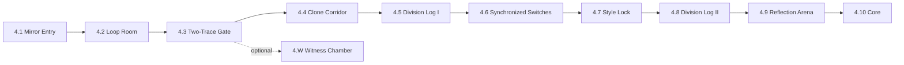
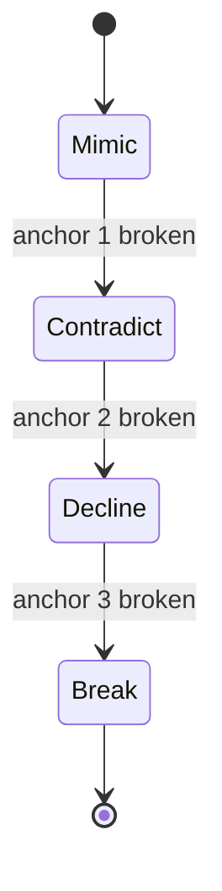

# 08 — Chapter 4: The Mirror Lab

**Theme:** Identity · **Spotlight:** Echo · **Playable:** all five · **Boss:** Reflection · **Shard:** IV Identification · **Trace slots:** 2 from 4.3

## 1. Narrative purpose
The most important evidence chapter: the **Division Log** reveals what the heroes are and what Prime Echo planned, and shows that no consent was recorded. The chapter forces the player to vary their approach.

## 2. Visual direction
Floating labs in a void with reflective floors/walls, liquid-mirror sky with static pulses, tiles that glow when stepped on. Palette: cool silver-blue, violet reflections, faint pink at reflection edges. Visual clarity rule: reflection never obscures the real character (contrast by outline).

## 3. Level progression

| Room | Purpose | Rules |
|---|---|---|
| 4.1 | Reflective surfaces; reflection mimics | Reflection |
| 4.2 | Loop room: exits repeat unless solved | Loops |
| 4.3 | Unlock Trace slot 2 | Two traces |
| 4.4 Clone Corridor | Clone blocks last solution class | Variety |
| 4.5 Division Log I | Environmental replay of the Draft (non-interactive) | Story |
| 4.6 | Synchronized mirrored switches | Sync |
| 4.7 | Style Lock: door requires a different method each pass | Variety |
| 4.8 | Division Log II: "CONSENT: NOT REQUESTED" | Story |
| 4.9 | Reflection | Boss |
| 4.10 | Shard IV; Ch1 terminal updates | — |
| 4.W | **Reveal** | Two traces |

## 4. Abilities introduced/tested
Second trace slot (4.3); all heroes' abilities in varied combinations; mirror-based sync.

## 5. Puzzles
- **4.2 Loop:** a four-exit room where the correct exit is the one the player has *not* used. **Solution:** vary the route. **Fair:** room shows a faint tally of used exits.
- **4.4:** the clone blocks the route used in the prior room (jump route vs dash route). **Solution:** use the other. **Failure:** none punitive; the clone just stands.
- **4.6:** two mirrored switches with Sync Window 2.0 s. **Solution:** one trace + live hero, or two traces.
- **4.7 Style Lock:** door asks for "movement," "ability," "trace" in a different order each time; completes after one of each. Teaches the Reflection boss.

## 6. Enemies and boss
Shadow Clones; Reflection (`03` C4).

## 7. Environmental storytelling
The Division Log plays as ghost-room tableaux: five translucent figures standing in a circle, each labeled with a strategy; one figure at the center. A line: "MERGE ON COMPLETION." A missing field: "CONSENT: —". The Ch1 terminal now shows the full DERIVATIVE entry on return.

## 8. Checkpoints and difficulty
Beacons before 4.3, 4.6, 4.7, 4.9, and each anchor. Difficulty: conceptual rather than mechanical; avoid pure execution spikes.

## 9. Assets
Mirror tiles, reflection shader/overlay, loop room set, clone sprite (silhouette), Division Log figures (5), anchors, Reflection sprite, reflected-glow VFX.

## 10. Entry/exit knowledge
- **Entry:** abandoned memories are guarded; heroes have sigils on a seal.
- **Exit:** the heroes were the Final Draft; a merge was planned; consent not recorded; Voidcaller is the Boundary Keeper (strongly implied).

## 11. Mystery contribution
R4.

## 12. Exit and completion
Exit: Shard IV; Core door opens to Hub. Complete: Reflection resolved, Shard IV, Beacon. Optional: 4.W clause 4 (*Reveal*).
