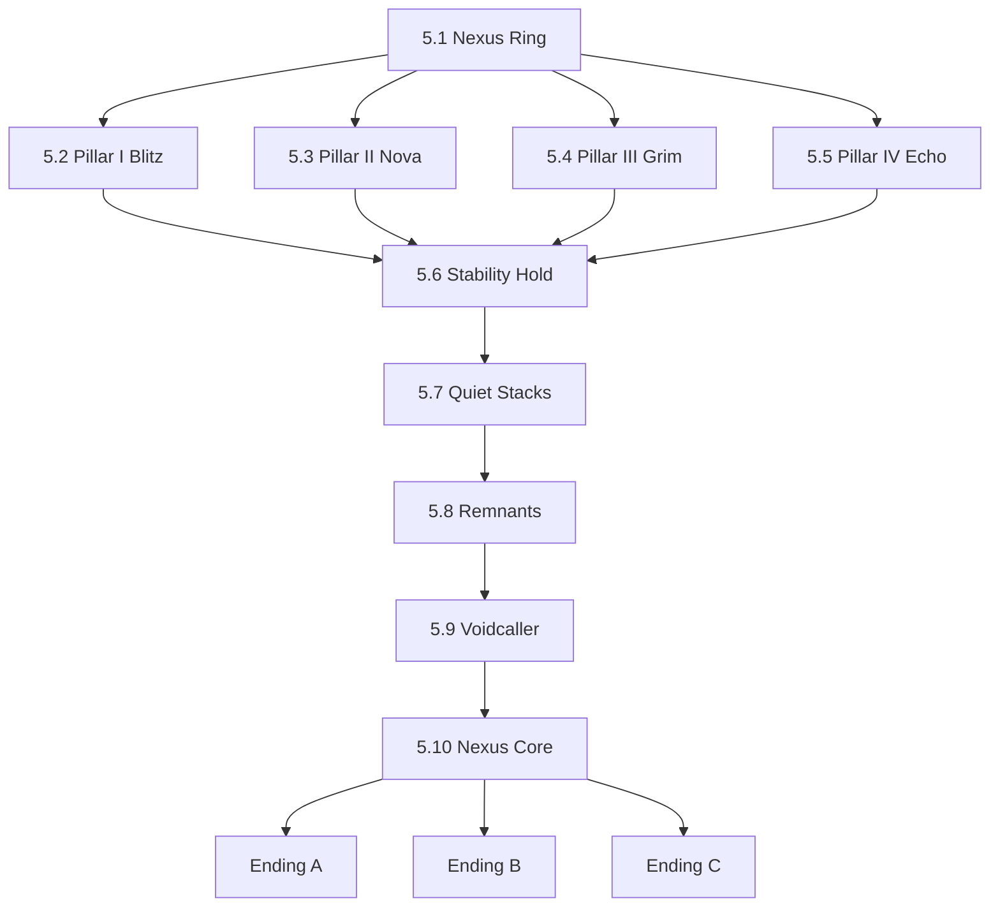
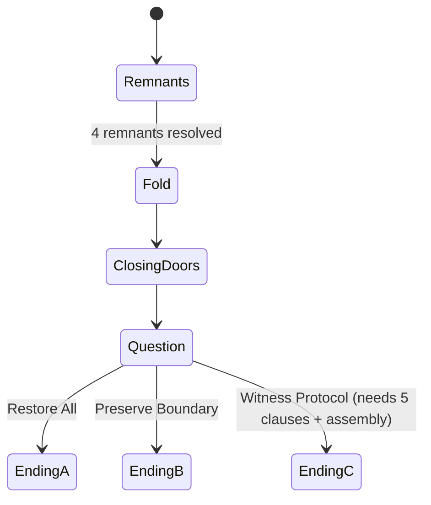

# 09 — Chapter 5: The Nexus Gate

**Theme:** Choice · **Spotlight:** Volt · **Playable:** all five · **Boss:** Voidcaller · **Shard:** V Arbitration

## 1. Narrative purpose
Recombine every rule, resolve the mystery, and put the choice in the player's hands. Defeating the Voidcaller physically is not a requirement for resolving the story.

## 2. Visual direction
A neural chamber with five floating pillars, a neural lightning storm, faces in clouds, glowing neuron crystals reacting to proximity; the outer ring of portal gates opens as Shards are returned. The Quiet Stacks are low, silent, pale. Palette is the full set (blue/purple/pink/cyan) at higher saturation, then drained for the Stacks.

## 3. Level progression

Pillar order is free for I–IV; Pillar V (Volt) opens after the Stability Hold.

| Room | Purpose | Rules |
|---|---|---|
| 5.1 Nexus Ring | Hub; portals to the four chapters (revisit) | — |
| 5.2 Pillar I (Blitz) | Dash + Trace sync under Corruptor-remnant | Ch1 rules |
| 5.3 Pillar II (Nova) | Gravity + relay with Stormhawk-remnant | Ch2 rules |
| 5.4 Pillar III (Grim) | Noise route with Titan-remnant | Ch3 rules |
| 5.5 Pillar IV (Echo) | Variety door with Reflection-remnant | Ch4 rules |
| 5.6 Stability Hold | All pillars drain; keep ≥ 70% for 90 s via short tasks | Mixed |
| 5.7 Quiet Stacks | Quiet traversal; Release Seals; heroes' seals | Noise + Veil |
| 5.8 Remnants | Pillar V trial (Volt): hack a rule-switch while remnants circle | Combined |
| 5.9 Voidcaller | Fold, Closing Doors, The Question | New: Fold |
| 5.10 Nexus Core | Prime Echo; the choice; Protocol Assembly | — |

## 4. Abilities introduced/tested
All. New rule: **Fold** (position swap with Trace, telegraphed).

## 5. Puzzles
- **Pillar trials:** each recombines its chapter's rule with one twist (Pillar I: two Pylons plus a Seam; II: relay plus reversed gravity; III: noise plus a trace decoy; IV: variety plus two traces).
- **Stability Hold (replaces the original 70%/3 min wave defense):** pillars lose integrity in pulses; players restore via nearby switches using Trace + abilities. Hold ≥ 70% for 90 s (tunable; Assist 60 s). `[PROTOTYPE]` for balance.
- **Protocol Assembly (Ending C):** five clause tablets (Offer, Identify the owner, Confirm consent, Reveal, Release) must be ordered. Hints draw from Witness Chamber testimonies; wrong orders show a *preview* of harm.

## 6. Enemies and boss
Echo-Fusions (two behaviors combined), Remnants, Voidcaller.

## 7. Environmental storytelling
Stacks walls of Release Seals; one wall of five seals carries the heroes' marks and reads, in plain text: "RELEASED FROM: PRIME ECHO." Prime Echo's recorded fragments play at the Core: "If it happened, it belongs here." The Voidcaller's faces include accidental-loss faces and chosen-leave faces; the game does not tell which is which.

## 8. Checkpoints and difficulty
Beacon at each pillar entrance, after each pillar, before 5.7, between Remnants, and between phases. Difficulty: highest in the game, but with mostly known rules.

## 9. Assets
Pillar set (5), neuron crystals, storm VFX, cloud faces, Remnant sprites (4), Echo-Fusion variants, Stacks tileset, Seal walls, Voidcaller (large), Prime Echo figure, Core terminals, ending vignettes (3 sets × 5 heroes).

## 10. Entry/exit knowledge
- **Entry:** four Shards, the Draft, the planned merge.
- **Exit:** the player's choice and its consequences.

## 11. Mystery contribution
R5 and resolution.

## 12. Exit and completion
Exit: the Nexus Core choice. Complete: any ending; Ending C requires five clauses and Assembly. Witness Chambers remain revisitable via the Nexus Ring until the choice.
